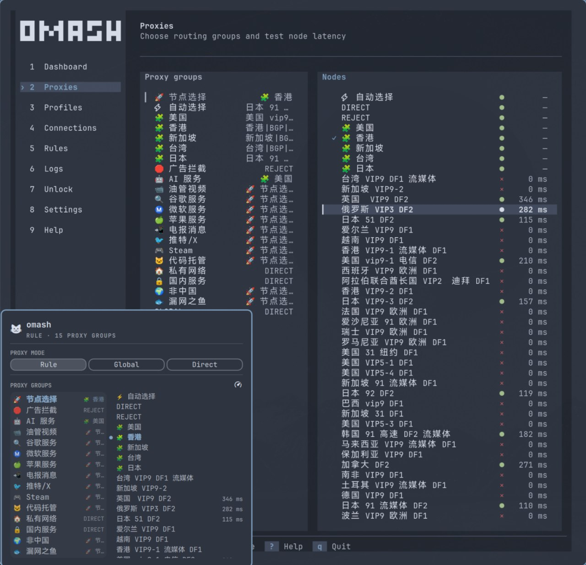
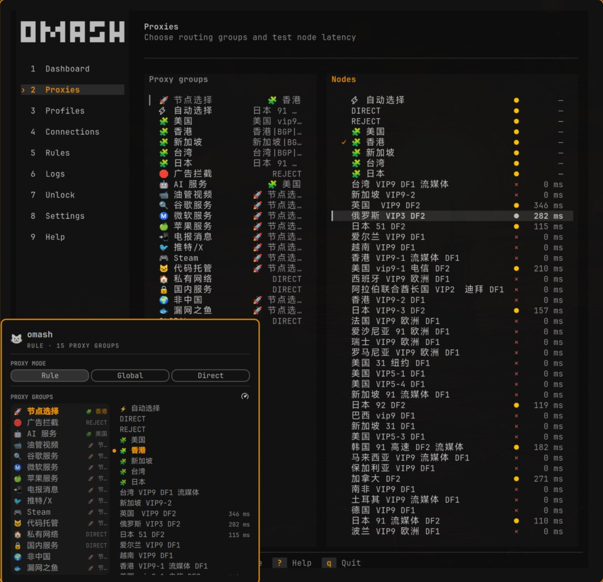

```text
 ██████╗ ███╗   ███╗ █████╗ ███████╗██╗  ██╗
██╔═══██╗████╗ ████║██╔══██╗██╔════╝██║  ██║
██║   ██║██╔████╔██║███████║███████╗███████║
██║   ██║██║╚██╔╝██║██╔══██║╚════██║██╔══██║
╚██████╔╝██║ ╚═╝ ██║██║  ██║███████║██║  ██║
 ╚═════╝ ╚═╝     ╚═╝╚═╝  ╚═╝╚══════╝╚═╝  ╚═╝
```

`omash` is forked from
[Clash Verge Rev](https://github.com/clash-verge-rev/clash-verge-rev) and
reworked as a fast, native terminal dashboard for Mihomo, built for
[Omarchy](https://omarchy.org/). It carries the upstream Mihomo management
design into a Rust TUI without a browser runtime.

The TUI is only the control surface. Mihomo runs under a user-level supervisor,
so closing `omash` does not stop your proxy.

<p align="center">
  
  
</p>

## Features

- Imports local profiles and remote subscriptions, with scheduled updates
- Runs either the system Mihomo or sing-box core, auto-detected per profile
- Supports Rule, Global, and Direct modes, proxy selection, and delay tests
- Manages active connections, Merge enhancements, backups, and logs
- Uses the system Mihomo and GeoIP packages maintained by Omarchy
- Keeps Mihomo running through a user service after the TUI closes
- Offers optional Mihomo TUN with a capability-limited system helper
- Updates `gsettings` and the UWSM/systemd environment for newly launched apps
- Follows the active Omarchy palette, with optional theme overrides
- Provides an optional Omarchy Shell widget for common controls

## Install

Install the system dependencies first:

```bash
omarchy pkg aur add mihomo clash-geoip

# Only needed for sing-box profiles:
omarchy pkg pacman add sing-box

# Only needed when Cargo is not already installed:
omarchy install dev-env rust
source "$HOME/.cargo/env"
```

Install `omash`, then launch it once to finish setup:

```bash
curl -fsSL https://raw.githubusercontent.com/ourongxing/omash/main/scripts/install | bash
omash
```

The installer writes the binary and user service under your home directory; it
does not install system packages or use `sudo`. On first launch, `omash` creates
its configuration, starts the supervisor, and enables login startup because
`auto_start = true` by default.

### Install from source

After installing the dependencies above, build and install manually:

```bash
git clone https://github.com/ourongxing/omash.git
cd omash
cargo build --locked --release

install -Dm755 target/release/omash "$HOME/.local/bin/omash"
systemd_user_dir="${XDG_CONFIG_HOME:-$HOME/.config}/systemd/user"
install -Dm644 systemd/omash-supervisor.service \
  "$systemd_user_dir/omash-supervisor.service"
sed -i 's|^ExecStart=.*|ExecStart=%h/.local/bin/omash --daemon|' \
  "$systemd_user_dir/omash-supervisor.service"
systemctl --user daemon-reload

omash
```

### Optional Shell widget

The installer does not add the Omarchy Shell widget. Install it from the public
repository:

```bash
omarchy plugin add https://github.com/ourongxing/omash.git --enable
```

Or install it from a source checkout while in the repository root:

```bash
mkdir -p ~/.config/omarchy/plugins
cp -r integrations/omarchy/ourongxing.omash ~/.config/omarchy/plugins/
omarchy plugin enable ourongxing.omash --section right
```

The widget appears immediately and supports mode changes, proxy selection, and
delay tests. It calls `omash bar` and does not access the Mihomo API secret.

### Update

From `0.1.3` or newer, rerun the installer to update in place:

```bash
curl -fsSL https://raw.githubusercontent.com/ourongxing/omash/main/scripts/install | bash
```

Versions before `0.1.3` used a system-wide `/usr` layout and must be uninstalled
first:

```bash
curl -fsSL https://raw.githubusercontent.com/ourongxing/omash/main/scripts/uninstall | bash
curl -fsSL https://raw.githubusercontent.com/ourongxing/omash/main/scripts/install | bash
```

Configuration, profiles, logs, and backups are preserved. The old-version
uninstaller removes the optional widget, so add it again after updating.

## Controls

| Key | Action |
| --- | --- |
| `1`-`8` | Open a page |
| `Up` / `Down`, `j` / `k` | Move the selection |
| `Tab`, `Left` / `Right`, `h` / `l` | Switch between proxy groups and nodes |
| `Enter` | Run the selected action |
| `r` | Refresh now |
| `?` | Toggle shortcut help |
| `q`, `Ctrl-C` | Exit the TUI without stopping Mihomo |

Press `?` for the complete shortcut list. Mouse input is also supported.

## CLI

Besides the TUI, `omash` provides commands to control the proxy core from
scripts and the shell. They go through the supervisor, so the system proxy is
applied and cleared consistently:

```bash
omash stop     # stop the core and clear the system proxy
omash start    # start the core and re-apply the system proxy
omash restart  # restart the core (e.g. after editing config.toml)
```

Use them for controlled configuration changes, for example when moving the
proxy to a different port: `omash stop`, edit `mixed_port` in
`~/.config/omash/config.toml`, then `omash start`. Note that applications
launched through UWSM/systemd keep the proxy port captured at launch time, so
running applications may need a restart after a port change.

## Mihomo TUN (Linux/systemd)

**Keep starting omash as usual:**

```bash
omash
```

TUN is optional and **off by default**. Existing proxy use requires no extra
setup. Enable TUN if you want Mihomo to also handle traffic from applications
that do not use the system proxy.

### Enable TUN for the first time

1. Import and select a working **Mihomo** profile in omash.
2. Press **7** for **Settings**, use the arrow keys to select **Mihomo TUN**,
   and press **Enter** to turn it on.
3. The first time, omash asks whether to install its network helper. Press
   **y**: omash leaves its screen and runs `sudo` in the same terminal. Enter
   your administrator password, then press **Enter** to return. omash turns TUN
   on (also starting the core if it was stopped) and shows the result below the
   settings. Press **n** to keep TUN off.

Instead of steps 2–3, you can install the helper from any terminal as your
normal desktop user, then turn TUN on in Settings or with `omash tun on`:

```bash
omash tun setup
```

**After that, just run `omash`.** The TUN setting is remembered. Closing the
TUI with `q` leaves the proxy running. To turn TUN off, use the same Settings
switch; ordinary proxy operation continues.

After upgrading omash, run `omash tun setup` once to update the installed
helper; if the background supervisor still runs the replaced omash binary,
setup restarts it. You do not need to run it each time you start omash. When
Settings reports that the helper is outdated (a protocol mismatch), you can
instead turn TUN off and on there and confirm the update.

<details>
<summary>Optional terminal commands, configuration and troubleshooting</summary>

### Optional terminal commands

These are alternatives to the Settings switch or tools for maintenance. They
are **not a startup checklist**.

| Command | When to use it |
| --- | --- |
| `omash tun on` | Enable TUN from a terminal instead of Settings; wait until active, or report a failure. |
| `omash tun off` | Disable TUN and keep using the ordinary proxy. |
| `omash tun status` | Check the requested and current TUN state. |
| `omash tun doctor` | Inspect permissions, runtime state and routing without changing them. |
| `omash tun uninstall` | Disable TUN and remove its helper, preserving profiles and data. |

The Settings switch shows the requested and applied state (`active`,
`starting`, `disabled`, `failed` or `unavailable`). Like `omash tun on`, it
refuses a sing-box profile and starts a stopped core, and the notice below the
settings reports the result. A change made while the switch, `omash tun on/off`
or `omash tun uninstall` waits (a node selection, a profile update) gives the
supervisor a newer revision; they follow it instead of reporting a timeout, and
say so when TUN was switched again elsewhere. The background supervisor never
starts an authorization prompt; the TUI runs `sudo` only after you confirm
installing or updating the helper, and keeps TUN off when you decline or setup
fails.
`omash tun on` without a helper keeps TUN requested instead. While the helper
is missing or does not answer, for example right after login, omash keeps an
ordinary proxy running without TUN (shown as `unavailable`) and returns to TUN
by itself once the helper answers.
TUN defaults to off, including when migrating the obsolete `tun` setting. It is
independent of the system proxy and Rule/Global/Direct mode. Toggling TUN
preserves a live mode selection for the same profile; an explicit mode change
in the profile still takes effect. The preference is retained when selecting a
sing-box profile, but this helper only manages Mihomo TUN.

### Permissions and background operation

Setup uses `sudo` in a terminal, or `pkexec` when available outside a terminal.
It installs `/usr/local/libexec/omash-tun-service`,
`/etc/systemd/system/omash-tun.service`, and `/etc/omash-tun.json`.
The system unit runs **as the installing user**, with only `CAP_NET_ADMIN` and
`CAP_NET_RAW`, `NoNewPrivileges`, restricted filesystem writes, a native
`@system-service` syscall filter, no namespace creation or writable-executable
memory, and `/dev/net/tun` as its only extra device. It does not add SUID or
file capabilities to `/usr/bin/mihomo`. The system Mihomo package,
`iproute2`, `nftables`, and `getcap` (libcap) are required. Only one installing user is
supported per machine. The controller must use a loopback IP and a nonempty
secret. Custom XDG data paths must be absolute, owned by that user, and contain
only ASCII letters, digits, `/`, `.`, `_` and `-`.

**Security note:** the helper identifies its caller by UID, not by program. Any
process running as the installing user can talk to it and can start a Mihomo
configuration of its choosing whenever the supervisor does not hold the lease
(the same user can also stop the supervisor). That lets such a process steer
system-wide routing and DNS. This is inherent to a user-owned helper: install it
only for an account whose processes you trust, and run `omash tun uninstall`
when you no longer need TUN.

The supervisor holds the helper's Unix-socket lease. Closing the TUI leaves it
running. Supervisor disconnects trigger graceful core termination; a stalled
connection has a two-minute lease limit. Normal stops send SIGTERM and wait up
to five seconds before a forced kill. The system unit also bounds shutdown of
its entire process group. A successful API response alone is insufficient:
omash checks the running core, reported TUN configuration and actual device.

Configuration changes are validated before stopping the current core, once per
switch; a rejection reports the core's own reason. Changed runtime
configurations restart the core, which briefly interrupts active connections.
Selection-only updates, also after switching the mode through the API, reload
the core in place and keep its process, the TUN device and the live
Rule/Global/Direct mode. A failed start restores the previous verified
backend/configuration when possible; no copy of the configuration is kept as a
"last good" file. Desired and applied revisions remain distinct and a failed
request keeps its error. Retries depend on the situation:

- No core is running (for example the first start after login failed): omash
  retries automatically, with a delay that doubles from 5 s up to 30 s, and
  clears the error as soon as an attempt succeeds.
- TUN is requested but the helper is unavailable: the ordinary proxy runs
  without TUN, so connectivity does not depend on the helper, while omash keeps
  probing the helper with the same delays and switches to TUN as soon as it
  answers.
- Any other failed change while a core keeps running (an invalid profile, a
  routing conflict, a busy port) is not retried. Fix the cause and issue
  `omash tun on` again. A TUN attempt that fails this way and leaves no core
  running is followed by the ordinary proxy without TUN until you do.

### TUN and DNS defaults

With the `mixed` or `system` stack, the helper automatically allows packets
reinjected from its own TUN interface into existing nftables input filter chains,
including UFW's iptables-nft backend. Profiles need no firewall workaround. It
checks these exceptions every two seconds, restores them after a firewall reload,
and removes them on stop, failed startup, core exit and helper restart. Rules are
tagged by the installing UID; cleanup matches both the tag and the exact rule
shape. Existing policies, other interfaces, output and forwarding rules are left
alone. The `gvisor` and `mips` stacks do not need these exceptions.

Rules of the legacy iptables (xtables) backend are invisible to nftables and are
not managed. `omash tun doctor` reports a loaded legacy filter module; such a
firewall must allow the TUN interface itself. This integration handles local
input filtering; it does not configure a router or override output/ingress
filtering. A failure to install an exception prevents TUN from being reported
active and is included in `omash tun status` and `omash tun doctor`; a failed
removal is retried in the background and does not fail a stop, but
`omash tun uninstall` keeps the helper until it confirms the removal. After this
update, run `omash tun setup` once: the helper protocol is now version 2.

Profile and Merge settings are preserved. omash owns the top-level TUN enable
bit and rejects additional `type: tun` listeners. Missing values are filled with:

- Device `omash-tun`, stack `mixed`, automatic routing and interface detection.
- UDP and TCP DNS interception on port 53; `auto-redirect` and `strict-route` off.
- Internal DNS enabled. If absent, `enhanced-mode: fake-ip`, range
  `198.18.0.1/16`, and both bootstrap resolvers and upstreams `1.1.1.1`, `8.8.8.8`.
  Existing upstreams, enhanced mode, policies and filters are preserved; empty
  upstream lists are rejected. Choose reachable DNS servers in your profile
  or Merge when these defaults are unsuitable for your network.
- With `fake-ip` DNS, `profile.store-fake-ip: true` unless your profile sets it
  itself, so addresses handed out before a core restart keep working after it.
- With IPv6 enabled, a missing TUN IPv6 address is filled with
  `fdfe:dcba:9876::1/126`. **IPv6 off does not block native IPv6 traffic in the OS**
  and is not an IPv6 leak-prevention firewall.

Existing TUN devices and conflicting policy-routing tables or rule priorities
(including the auto-redirect fallback priority when route address sets put
auto-redirect in mark mode) are checked before activation and on every Apply.
At start the helper records only the rules shaped like Mihomo's own: within its
rule span (rule index to +10) looking up its table or the main table, jumping
within that span, or doing nothing (nop), plus the fallback rule. With
`auto-route: false` and an IPv6 address, Mihomo instead adds one IPv6 rule
sending the TUN device's output to its table, just below the lowest priority
in use; that rule is recorded, its table is checked like the others, and a
start that would put it at a reserved priority (0, 32766 or 32767) is
refused. If the snapshot taken after the start shows any other rule in the TUN
table, rule range or fallback priority, the start fails as a conflict. A
foreign rule shaped exactly like Mihomo's cannot be told apart. Mihomo itself
deletes every rule in its rule span (and, in mark mode, at the fallback
priority) when it starts and when it stops, whoever added them; without
auto-route it deletes the first IPv6 rule at its IPv6 rule's priority when it
stops. A rule another program puts there after the check, or while TUN runs,
is removed by Mihomo, and omash can neither prevent nor always detect it. While TUN is running, only the exact rules and device
routes recorded at its start are excluded from the conflict check. Forced termination of Mihomo (for example `kill -9`) leaves its
policy rules behind. The helper remembers the rules its own core created, in
memory and in `tun-service/owned-rules.json`, and removes them before the next
start, so the supervisor's normal retry brings TUN back within seconds. It does
so only within the same boot and network namespace and only when every rule at
those priorities is one it created. Each rule is deleted by every field the
kernel compares, and a rule that cannot be described that way is kept. The
kernel has no way to delete one exact rule: it ignores a goto target and `not`
and treats fields left out as wildcards, so a rule replaced between the check
and the deletion by one that differs only there can still be deleted. Rules recalled from that file after a helper
restart are claimed only within Mihomo's default scope (table 2022, rule
priorities 9000-9019), because the user can write the file; rules a running
helper remembers in memory are cleaned for any configured table and priority. If
anything else shares those priorities, nothing is deleted and the usual conflict
error is reported; omash then keeps an ordinary proxy running without TUN until
you resolve the conflict and run `omash tun on` again. `omash tun doctor`
inspects rules but never flushes routes or firewall rules; confirm ownership
before manually cleaning anything else, since other VPNs may own it.
Docker/VPN routing and unusual DNS policies should be checked in your own
network before relying on full-device interception.

### Updates and removal

After updating the client, run `omash tun setup` again to update the helper; the
automatic cleanup of leftover rules needs the updated helper. This is an
explicit administrative operation. The normal installer checks an
existing helper's protocol before restarting the supervisor; if it cannot
confirm compatibility, it leaves the current supervisor running and prints an
update instruction; `omash tun setup` then restarts a supervisor that still
runs the replaced binary. Uninstall waits for the supervisor to disable TUN and
restore the ordinary proxy before removing the helper. If that switch fails,
the helper is kept and the command reports the error. The helper is also kept
while it cannot confirm, within about ten seconds, that it removed its firewall
exceptions: it keeps retrying in the background, and you can run uninstall
again once the cause is fixed. Only a helper older than protocol version 2,
which adds no exceptions, or a stopped helper unit that reported no failure is
removed without that confirmation. The client is removed after the helper.
Profiles, cached assets and logs stay in your data directory.

TUN commands use the supervisor's default configuration path. For a custom
location, use the same `XDG_CONFIG_HOME` and `XDG_DATA_HOME` for setup, client and
supervisor; `--config` is rejected for managed TUN commands.

</details>

## Remove

Remove the widget, user service, binary, and legacy system files with:

```bash
curl -fsSL https://raw.githubusercontent.com/ourongxing/omash/main/scripts/uninstall | bash
```

The uninstaller preserves `~/.config/omash` and `~/.local/share/omash`, which
contain your configuration, profiles, logs, and backups. Remove those
directories manually if you also want to delete user data.

## Configuration

The main configuration file is `~/.config/omash/config.toml`. Runtime data is
stored in `~/.local/share/omash/`.

```toml
controller = "http://127.0.0.1:9090"
secret = ""
refresh_ms = 1500
delay_test_url = "https://www.gstatic.com/generate_204"
auto_start = true
mixed_port = 7897
allow_lan = false
ipv6 = true
system_proxy = true
tun_enabled = false
proxy_bypass = "localhost,127.0.0.1,::1,192.168.0.0/16,10.0.0.0/8,172.16.0.0/12"
```

`OMASH_REFRESH_MS` and `--refresh-ms` override the configured refresh interval.
Use `--config <path>` to load a different configuration file.

The core starts with only `PATH=/usr/bin:/bin` and `HOME` in its environment,
with or without TUN, so a configuration validates and runs the same either way.
Variables set for omash, such as `SAFE_PATHS`, `SSL_CERT_FILE` or proxy
variables, do not reach the core.

### sing-box profiles

In addition to Clash/Mihomo YAML, profiles may be sing-box JSON configs,
either imported from a local file or served from a subscription URL. omash
detects the format from the profile content and runs the matching system core
(`/usr/bin/mihomo` or `/usr/bin/sing-box`). For sing-box it injects a managed
`experimental.clash_api`, a mixed inbound on `mixed_port`, and `clash_mode`
route rules for Global/Direct (unless the config already defines its own), so
the dashboard, mode switching, delay tests, and the system proxy keep working
the same way. Clash-style merge and prepend/append enhancement chains only
apply to Mihomo profiles.

### Theme override

The TUI follows the current Omarchy palette by default. To override it:

```bash
mkdir -p ~/.config/omash
cp themes/default.toml ~/.config/omash/theme.toml
```

Changes reload automatically. Remove the file to follow Omarchy again; available
fields are documented in [`themes/default.toml`](themes/default.toml).

## Development

```bash
cargo fmt --check
cargo clippy --locked --all-targets -- -D warnings
cargo test --locked
cargo build --locked --release
python3 scripts/check-tun-traffic.py self-test

# Disposable Linux/systemd VM only; refuses an existing TUN helper installation.
# It tests target/debug/omash (build it with `cargo build`) unless
# OMASH_TEST_BINARY names another binary:
cargo build
sudo --non-interactive bash scripts/check-tun-linux
sudo --non-interactive env OMASH_TEST_BINARY="$PWD/target/release/omash" \
  bash scripts/check-tun-linux
```

GitHub Actions (`.github/workflows/ci.yml`) runs the formatting, clippy, unit
test and traffic-checker self-test steps above, plus a syntax check of the
scripts, on every push to `main` and every pull request. The Linux check below
needs root, a systemd user manager and the real Mihomo, so run it by hand on a
VM.

The Linux check creates a temporary user (with its data directory under `/home`,
so the helper unit's read-only home mount is exercised), user manager and
network namespaces. It exercises the real system Mihomo with local dual-stack
TCP/UDP/DNS peers, permission and protocol rejection, rollback after a startup
failure, selection-only reloads, one validation per switch, a rejected
configuration's reason, `kill -9` recovery (including leaving foreign rules
alone), fake-IP persistence across a core restart, automatic retry and the
ordinary-proxy fallback while the helper is down, the Settings toggle in the
real TUI (including starting a stopped core), `omash tun setup` and `uninstall`
through a sudoers entry limited to those exact commands (including setup
restarting a supervisor left on a replaced binary, and uninstall keeping a
helper that cannot remove its firewall exception while nft is temporarily
executable by root only), installing the helper from the TUI's Settings page
(declined, a sudo prompt ended without a password, and a password typed into
sudo in the same terminal, for a temporary password of the test user and a
sudoers entry limited to the install command), `omash tun on` and `uninstall`
following a revision that a profile change made while they waited superseded,
uplink changes,
conflicts during Apply, preservation of simulated VPN/container routes and lease
cleanup. TCP and UDP each use reachable and rejected destinations for both
address families, with all destinations
reachable before TUN and after it is disabled. The check also verifies that host
routes are unchanged. Default-deny input filtering stays enabled throughout;
recreating the firewall must restore traffic without restarting Mihomo, and
turning TUN off must remove its exceptions. The whole run keeps the legacy
`ip_tables` kernel module loaded (loading it if needed and unloading it again at
exit), so its root-only table list cannot block the unprivileged helper. It needs
`iproute2`, `nftables`, `kmod`, `libcap`, Python 3, curl, dig, sudo/visudo,
`chpasswd`, util-linux `script`, and the normal Mihomo/GeoIP packages, and names any
prerequisite that is missing. All test resources are cleaned up on exit, and
nft's original file mode is restored if the run stopped while it was changed;
non-secret diagnostic files stay in the printed temporary directory.

The narrower firewall regression can also run without sudo on a Linux system
that allows unprivileged user/network namespaces. Install UFW (using
iptables-nft), nftables, Mihomo, Python and util-linux, then run:

```bash
cargo test --no-run
# Use the test executable path printed above:
OMASH_FIREWALL_PARENT_NETNS="$(readlink /proc/self/ns/net)" \
  unshare -Urn env OMASH_FIREWALL_TEST=1 target/debug/deps/omash-<hash> \
  --ignored --exact tun::firewall::tests::kernel_traffic --nocapture
```

It uses real UFW with a temporary configuration and an isolated pair of network
namespaces. It first reproduces the mixed-stack TCP timeout, then checks real
IPv4/IPv6 TCP/UDP, UFW reload, multiple input chains, custom TUN names, cleanup
and continued rejection of non-TUN inbound traffic, and that the `gvisor` and
`mips` stacks need no exception (the `mips` step needs Mihomo v1.19.31 or later
and is skipped with a `SKIP:` line on older versions). The host's UFW
configuration and network are untouched. `scripts/check-tun-firewall.py` is its
internal fixture.

For an explicitly authorized private profile, set `OMASH_TEST_PROFILE` to an
absolute file path in the sudo environment and install `slirp4netns`. The extra
check uses user-mode networking inside the namespace and verifies an external
HTTPS connection actually traverses a TUN inbound and a remote proxy. It matches
the connection's socket tuple and checks the outbound leaf type; a named group
that selects DIRECT does not pass. The
profile stays in the temporary user's home and is removed at cleanup. Native
IPv6 upstream reachability still depends on the host network.

## License

As a fork of Clash Verge Rev, `omash` remains licensed under GPL-3.0-only. The
full, unmodified license is retained in [`LICENSE`](LICENSE).
